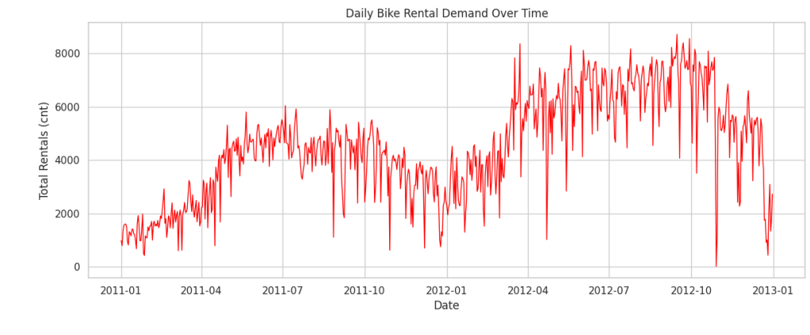
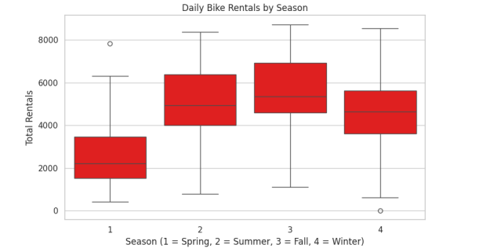
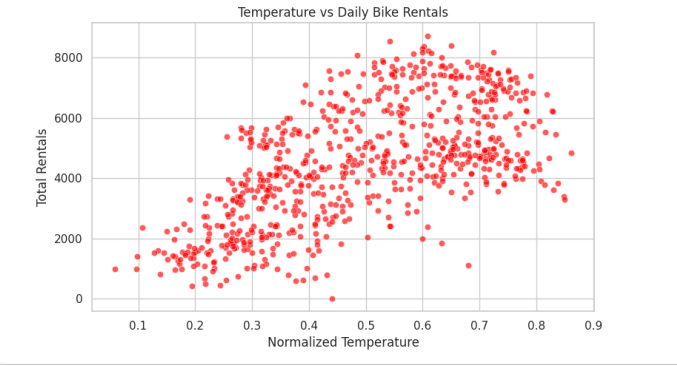
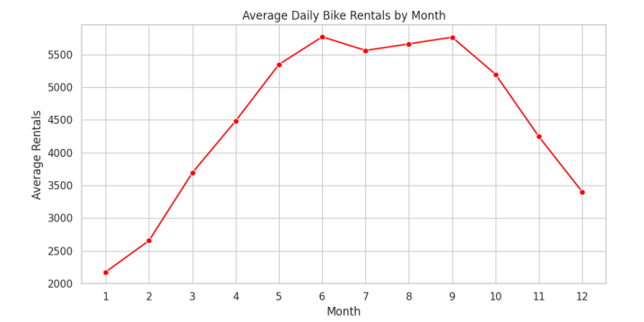
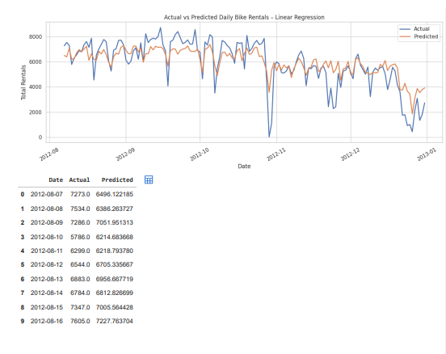
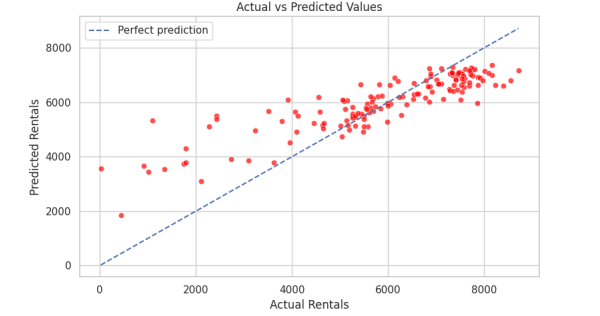
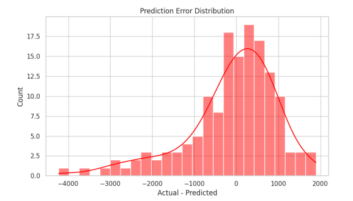

# Bike Sharing Demand Prediction

**Project| Predictive Analytics | Python & Machine Learning**

A regression-based analysis of daily bike rental demand using historical rental, calendar, seasonal, and weather data from the UCI Bike Sharing Dataset. This project explores demand patterns and compares Linear Regression with Random Forest using a chronological test set.

---

## Project Overview

Bike-sharing services need to estimate rental demand to help plan bicycle availability and daily operations. This project investigates the following question:

> **Can daily bike rental demand be estimated using historical calendar, seasonal, and weather information?**

The analysis uses the daily dataset (`day.csv`) as the modelling source. The hourly dataset (`hour.csv`) is included in the repository for reference, but it is not used in the daily prediction model.

- **Target:** `cnt` — total daily rental count
- **Dataset period:** 1 January 2011 – 31 December 2012
- **Daily observations:** 731
- **Models compared:** Linear Regression and Random Forest Regressor
- **Validation:** Chronological 80/20 train-test split

## Project Results at a Glance

| Metric | Linear Regression | Random Forest |
|---|---:|---:|
| MAE | 789.97 | 917.91 |
| RMSE | 1,091.14 | 1,128.03 |
| R² | 0.661 | 0.638 |

**Best-performing model in this experiment: Linear Regression**, based on the lower RMSE on the chronological test set.

The Linear Regression model achieved an MAE of 789.97 rentals, an RMSE of 1,091.14 rentals, and an R² of 0.661 on 147 held-out dates. These values describe this historical test period; they are not a guarantee of future or live-system performance.

## Dataset

**Source:** [UCI Machine Learning Repository – Bike Sharing Dataset](https://archive.ics.uci.edu/dataset/275/bike+sharing+dataset)

The data represents the Capital Bikeshare system in Washington, D.C., during 2011 and 2012. It includes rental counts together with weather, seasonal, and calendar information.

| File | Records | Columns | Purpose |
|---|---:|---:|---|
| `day.csv` | 731 | 16 | Daily rental data used for modelling |
| `hour.csv` | 17,379 | 17 | Hourly dataset included for reference; not used in this daily model |

### Important columns

| Column | Meaning |
|---|---|
| `dteday` | Date |
| `season` | Season code: 1 = Spring, 2 = Summer, 3 = Fall, 4 = Winter |
| `yr` | Year code: 0 = 2011, 1 = 2012 |
| `mnth` | Month |
| `holiday`, `weekday`, `workingday` | Calendar indicators |
| `weathersit` | Weather situation category |
| `temp`, `atemp` | Normalized temperature and feeling temperature |
| `hum`, `windspeed` | Normalized humidity and wind speed |
| `casual` | Casual user rental count |
| `registered` | Registered user rental count |
| `cnt` | Total rental count (target) |

**Target leakage prevention:** The dataset defines `cnt` as the sum of `casual` and `registered`. Both columns were excluded from the model predictors so that the model would not receive components of the target as input.

## Tools & Technologies

- Python
- Google Colab / Jupyter Notebook
- Pandas and NumPy
- Matplotlib and Seaborn
- Scikit-learn
- Linear Regression
- Random Forest Regressor

## Project Workflow

1. **Load and inspect data** – read `day.csv`, inspect dimensions, data types, sample rows, and target values.
2. **Check data quality** – examine missing values, duplicate rows, and date coverage.
3. **Prepare data** – parse the date, remove invalid date/target rows if present, remove duplicate rows, and sort chronologically.
4. **Feature engineering** – derive `date_year`, `date_month`, `date_day`, `date_dayofweek`, and `date_dayofyear`.
5. **Exploratory analysis** – examine daily rental trends, seasonal distributions, temperature relationships, and monthly averages.
6. **Chronological split** – use the earliest 80% of dates for training and the latest 20% for testing.
7. **Train models** – build preprocessing pipelines and train Linear Regression and Random Forest.
8. **Evaluate predictions** – compare MAE, RMSE, and R²; inspect actual-versus-predicted values and prediction errors.
9. **Export outputs** – save model metrics, test predictions, and chart images.

### Data quality summary

- Daily dataset shape: **731 rows × 16 columns**
- Missing values: **0**
- Duplicate rows: **0**
- Date range: **2011-01-01 to 2012-12-31**
- Mean daily rentals: **4,504.35**
- Minimum daily rentals: **22**
- Maximum daily rentals: **8,714**

### Feature engineering and predictors

The notebook derives five date-related features from `dteday`. It then uses 15 predictors:

`season`, `yr`, `mnth`, `holiday`, `weekday`, `workingday`, `weathersit`, `temp`, `atemp`, `hum`, `windspeed`, `date_month`, `date_day`, `date_dayofweek`, and `date_dayofyear`.

The model excludes the row identifier, raw date, `casual`, `registered`, and target `cnt`.

### Model preparation

- **Linear Regression:** median imputation and standard scaling for numeric features; most-frequent imputation and one-hot encoding for categorical features.
- **Random Forest:** median imputation for numeric features; most-frequent imputation and one-hot encoding for categorical features.
- **Random Forest settings:** 400 estimators, maximum depth 8, minimum samples per leaf 3, `random_state=42`.

### Train-test split

| Set | Records | Date range |
|---|---:|---|
| Training | 584 | 2011-01-01 to 2012-08-06 |
| Testing | 147 | 2012-08-07 to 2012-12-31 |

The split follows date order rather than randomly shuffling observations, so the evaluation uses later dates as the holdout period.

## Data Visualizations

The following charts were generated from the supplied `day.csv` dataset and the model evaluation run. The image paths are relative to this repository, so GitHub will render them directly below.

### 1. Daily Bike Rental Demand Over Time



**File:** `01_daily_bike_rental_demand.png`  
Shows how daily rental counts changed throughout 2011 and 2012.

### 2. Daily Bike Rentals by Season



**File:** `02_daily_rentals_by_season.png`  
Compares the distribution of daily rental counts across the four seasons.

### 3. Temperature vs Daily Bike Rentals



**File:** `03_temperature_vs_daily_rentals.png`  
Explores the relationship between normalized temperature and daily rental volume.

### 4. Average Daily Bike Rentals by Month



**File:** `04_average_daily_rentals_by_month.png`  
Compares average daily rentals across the twelve months.

### 5. Actual vs Predicted Daily Bike Rentals



**File:** `05_actual_vs_predicted_daily_rentals.png`  
Compares actual rentals with Linear Regression predictions over the 147-date test period.

### 6. Actual vs Predicted Values



**File:** `06_actual_vs_predicted_scatter.png`  
Shows the relationship between actual and predicted rental counts. The dashed diagonal indicates perfect predictions.

### 7. Prediction Error Distribution



**File:** `07_prediction_error_distribution.png`  
Displays the distribution of prediction errors, calculated as `Actual - Predicted`.

## Model Evaluation

The models were evaluated using three regression metrics:

- **MAE (Mean Absolute Error):** average absolute difference between actual and predicted rental counts. Lower is better.
- **RMSE (Root Mean Squared Error):** gives greater weight to larger errors. Lower is better.
- **R² (Coefficient of Determination):** indicates how much variation in the test target is explained by the model. Higher is generally better.

| Model | MAE | RMSE | R² |
|---|---:|---:|---:|
| Linear Regression | 789.97 | 1,091.14 | 0.661 |
| Random Forest | 917.91 | 1,128.03 | 0.638 |

Linear Regression performed better than Random Forest across all three reported metrics on this test split. This is an empirical result for this dataset and model configuration; it does not establish that Linear Regression will always be better for bike rental forecasting.

## Key Findings

- The daily dataset contains 731 observations with no missing values or duplicate rows.
- Average daily rental count across the full dataset was approximately **4,504**.
- Average rentals were highest in **season 3 (Fall)** at approximately **5,644** rentals per day.
- **June** had the highest monthly average at approximately **5,772** rentals per day.
- The temperature scatter plot suggests that rental demand generally tends to be higher at warmer normalized temperatures in this dataset; this is an observed association, not proof of causation.
- Linear Regression achieved the lowest test RMSE of **1,091.14** among the two models compared.

## Conclusion

This project used the UCI Bike Sharing Dataset to explore and predict daily bike rental demand from historical calendar, seasonal, and weather information. The daily dataset contained 731 observations covering 2011 and 2012. After data quality checks and date-based feature engineering, the data was split chronologically into 584 training records and 147 testing records.

Two regression models were compared. Linear Regression achieved the better result on the held-out test period, with an MAE of 789.97, RMSE of 1,091.14, and R² of 0.661. The exploratory visualizations also showed clear variation in rental demand across dates, seasons, months, and temperature levels. In the supplied data, Fall had the highest average seasonal rentals, while June had the highest monthly average.

Overall, the project demonstrates a complete predictive analytics workflow: data inspection, cleaning, feature engineering, exploratory data analysis, regression modelling, chronological evaluation, error analysis, and result export. The model is a historical experiment using 2011–2012 observations. Before operational use, it would need testing on newer data, repeated time-based validation, and future weather inputs for the forecast period.

## How to Run

### Google Colab

1. Open `notebooks/Bike_Sharing_Demand_Prediction.ipynb` in Google Colab.
2. Run the notebook cells in order.
3. When the upload cell appears, upload `data/day.csv`.
4. Review the data checks, visualizations, model comparison, and prediction error analysis.
5. The final cells export `bike_rental_test_predictions.csv` and `model_evaluation_results.csv`.

### Local Environment (VS Code / Jupyter)

1. Clone or download this repository.
2. Install the required libraries:

```bash
pip install -r requirements.txt
```

3. Open the notebook in VS Code or Jupyter.
4. If running outside Colab, replace the Google Colab upload cell with a local read such as:

```python
df = pd.read_csv("data/day.csv")
```

5. Run the remaining cells in order.

---

**Project:** Bike Sharing Demand Prediction  
**Focus:** Predictive Analytics · Regression · Machine Learning  
**Language:** Python  
**Notebook environment:** Google Colab  
**Dataset:** UCI Bike Sharing Dataset
